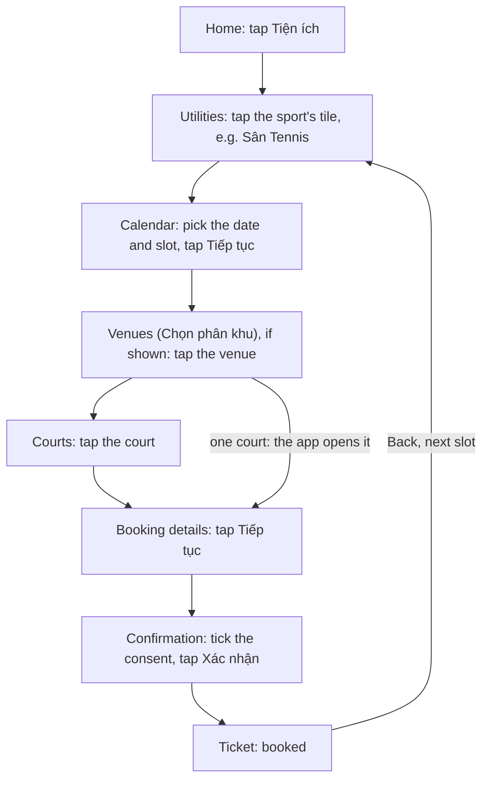
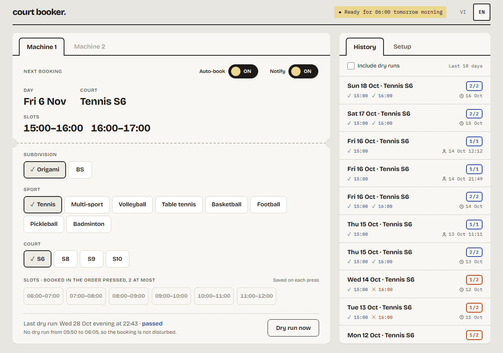
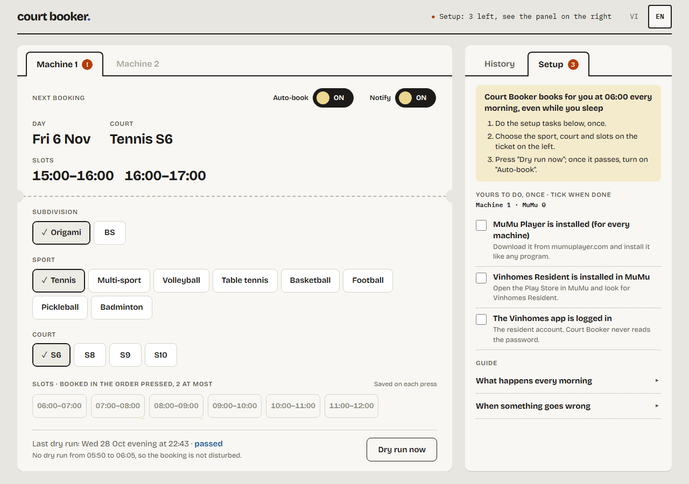

# vh-tennis-booker

[](https://github.com/servedbyhau/vh-tennis-booker/actions/workflows/ci.yml)


Books a sports court in the **Vinhomes Resident** app the moment bookings open, while its
owner sleeps.

**The problem.** The app opens each day's courts at 06:00, and the popular slots are gone
within seconds. Booking by hand means being awake, and fast, every morning.

**The approach.** A Windows scheduled task wakes the PC shortly before 06:00, starts the MuMu
Player Android emulator and taps through the app's own booking screens, as a person would.
Python reads each screen in one accessibility dump and finds every button by its label; a
small Android instrumentation driver written for the project does the taps, with
uiautomator2 as a fallback. It uses no private API and does not modify the app.

**The result.** It has booked real courts at 06:00 since 2026-10-10. On 2026-11-01,
two MuMu instances booked four slots in parallel, at Origami and BS; each first slot reached
its ticket within five seconds. Beside the booking engine there is a local FastAPI backend
and a React and TypeScript UI, in Vietnamese and English, for the settings, the schedule
and the history of every run, in a Tauri window.

It books tennis and the other courts a subdivision offers (multi-purpose, volleyball, table
tennis, basketball, football, pickleball, badminton), for the Origami and BS subdivisions so
far. It installs as a Windows app from one installer, with no Python needed, and updates
itself with one button.

> [!IMPORTANT]
> An educational, personal project, not affiliated with or endorsed by Vinhomes.


<sub>The app during a dry run. All screenshots show made-up data.</sub>

## Highlights

- **Unattended and on time.** The PC wakes from sleep, and the run keeps NTP time on a
  counter Windows does not set, so the first tap goes out 0.1 s after 06:00:00.
- **One read per screen.** Each screen is one accessibility dump (about 13 ms) searched
  locally, so waiting for a screen and finding its button cost the same single read.
- **Reports only what the app showed.** A slot counts as booked only once the app shows its
  ticket (the booking confirmation); otherwise the round fails with the app's own message,
  or as "outcome unknown", never as booked.
- **Built for a slow app and a fragile emulator.** A tap the app ignores is repeated, a slow
  screen is awaited up to 30 s, and a frozen emulator ends the run after 60 s instead of
  hanging until the next morning.
- **Several accounts at once.** Each extra MuMu instance books with its own account, court
  and slots, in a process of its own, so one that fails holds up no other.
- **Tested without a device.** Fakes replace the emulator, ADB, the clock and Task
  Scheduler; CI runs Ruff, pytest on Python 3.9 to 3.14, and the UI's checks, tests and
  build.

## How it works



The app is built with Flutter, which publishes its widgets to Android's accessibility tree
with their text in `content-desc`. The booker reads each screen in one dump, finds the
buttons by their labels, and the driver finds them again in the current tree before
clicking. Coordinates distinguish duplicate labels and locate unlabelled controls; the
uiautomator2 fallback taps the points from the dump. A page with a single choice (one
venue, one court) passes on to the next by itself, and the booker goes on from whichever
page it reads. Each slot in `config.toml` is booked
in its own round, and one Back from the ticket returns to the utilities list for the next
one. The app may be set to Vietnamese or
English: the booker tells which from the first screen and uses that language's labels. The
Vietnamese labels live in `config.toml`, so a change of wording in the app needs no code
change; the English ones are built in.

A real 06:00 run, abridged (times are the PC clock, which was 0.161 s behind: the first
tap went out at 06:00:00.001 and is logged once the calendar showed):

```text
05:50:02.583 INFO    court-booker 0.6.1
05:50:02.718 INFO    Clock offset +0.161 s
05:50:04.894 INFO    Launching MuMu instance 0
05:50:29.704 INFO    Android started after 24.8 s
05:50:38.583 INFO    Ready on the home screen
05:59:00.694 INFO    Tapped 'Tiện ích'
05:59:59.839 INFO    Round 1/2: 15:00 - 16:00
06:00:01.427 INFO    Tapped 'Sân Tennis'
06:00:01.594 INFO    Selected date 2026-10-18
06:00:03.360 INFO    Selected slot 15:00 - 16:00 (0 swipe(s))
06:00:05.954 INFO    Tapped 'S6 - Sân tennis'
06:00:06.232 INFO    Confirmation page: 2026-10-18 15:00 - 16:00 on S6 - Sân tennis
06:00:06.439 INFO    Accepted terms
06:00:07.979 INFO    Booking confirmed
06:00:07.981 INFO    Round 2/2: 16:00 - 17:00
...
06:00:10.564 INFO      OK   15:00 - 16:00  booked  (8.1s)
06:00:10.564 INFO      FAIL 16:00 - 17:00  Court S6 - Sân tennis is fully booked  (2.6s)
```

Further reading:

- [docs/how-it-works.md](docs/how-it-works.md): reading a Flutter app from the outside,
  navigation, lessons learned
- [docs/architecture.md](docs/architecture.md): what each module, backend route and UI part
  does
- [docs/field-notes.md](docs/field-notes.md): the facts about the app and the emulator the
  code relies on
- [docs/roadmap.md](docs/roadmap.md): the goal, what is left and the situations handled

## Install

What you need:

- A Windows 10 or 11 PC that stays on or asleep at night, never shut down (a PC that is off
  cannot be woken), plugged in and signed in to Windows (a locked screen is fine).
- [MuMu Player](https://www.mumuplayer.com/), with the Vinhomes Resident app installed in it
  and logged in to your resident account.

Then:

1. Download **[CourtBooker-setup.exe](https://github.com/servedbyhau/vh-tennis-booker/releases/latest/download/CourtBooker-setup.exe)**
   from the [newest release](https://github.com/servedbyhau/vh-tennis-booker/releases/latest).
2. Run it. The installer is not code-signed, so Windows SmartScreen may say it protected your
   PC: choose **More info**, then **Run anyway**. It installs for you alone, without
   administrator rights.
3. Open **Court Booker** from the Start menu. The **Setup** tab lists what only you can do
   (install MuMu and the Vinhomes app, log in); tick each step once it is done.
4. On the ticket, choose the subdivision, the sport, the court and up to two slots, in the
   order you want them.
5. Press **Dry run now** between 06:00 and 21:00, while the Vinhomes app takes bookings. It
   walks the whole booking and stops before the final confirmation, so nothing is booked.
6. Once it has passed, turn **Auto-book** on. Every morning the PC wakes at the wake time and
   books at 06:00; the window does not need to be open.

The app is in Vietnamese by default, English is one click away.

### Update

When a newer version is out, the top of the window shows **Update to x.y.z**. One press
downloads it, installs it over the app and opens it again; your settings, history and
morning booking stay. The button waits while a run is going on and around 06:00.

### Uninstall

In Windows Settings, open **Apps**, find **Court Booker** and choose **Uninstall**. This removes
the app and its morning booking. Your settings and history stay in
`%LOCALAPPDATA%\CourtBooker` (with the logs of every run, in `logs`); delete that folder to
remove them too.

## Using the app

The app is one screen, without a menu:

- **The line at the top** says whether the next start is ready, or the one thing to do first.
- **The ticket** on the left, a card drawn like a ticket, is the next booking in two parts:
  on top the daily switch (it creates or removes the Windows task, once a dry run passed)
  and what is set, the play day, court and slots; below, the subdivision, the sport, the
  court and up to two slots to choose, saved on each press, and a dry run. During a run it
  shows the steps as they happen.
- **Lịch sử / History** on the right: each run in two lines, its play day, court and count
  ("2/2"), then every slot booked or not and when it started (real bookings, dry runs on
  request); one click opens the reasons, the steps and the technical log.
- **Thiết lập / Setup** beside it: the steps only you can do (install MuMu and the Vinhomes
  app, log in), ticked by you, and a short guide; MuMu's place and screen and waking the PC
  need no step (the runs and the daily switch see to them). It
  opens first, with a count, while anything is left. The Windows notification switch sits on
  the ticket, beside the daily switch.
- **A tab per machine** on top of the ticket: "Máy 2" (a second MuMu instance, logged in to
  another account) books alongside the first once its "Dùng máy này" switch is on.

<p>
  
  
</p>

## Project layout

```text
src/court_booker/       booking engine and command line: emulator, ADB, flow, clock, history
src/court_booker/api/   FastAPI backend, which also serves the UI in the installed app
ui/                     the UI: React, TypeScript, Vite
desktop/                the window and the installer: Tauri, Rust
packaging/              the PyInstaller build of the engine and backend
android/                the instrumentation driver that taps in the emulator
tests/                  Python tests with a fake device, ADB, clock and Task Scheduler
tools/                  app build, release, screen inspector, OpenAPI export
docs/                   how it works, architecture, field notes, command line, roadmap, spec
```

[docs/architecture.md](docs/architecture.md) says what each module does.

## Development

```bash
git clone https://github.com/servedbyhau/vh-tennis-booker.git
cd vh-tennis-booker
pip install -e ".[dev,app]"
pre-commit install
pytest
cd ui && npm ci && npm test
```

[docs/command-line.md](docs/command-line.md) runs the engine, the backend and the UI from the
clone, with every command, setting and exit code. When the app changes its screens,
`python tools/inspect_screen.py --near "Tôi đã hiểu"` prints the elements around a label.
[CONTRIBUTING.md](CONTRIBUTING.md) covers the checks, conventions, branches, building the app
and releases.

## Roadmap

The 0.x versions go through four phases toward 1.0.0: it runs, it handles every situation,
it is fast, it is friendly to use. 1.0.0 is the first complete version: the desktop app with
its installer and update button, which books every morning ([changelog](CHANGELOG.md)).
See [docs/roadmap.md](docs/roadmap.md).

## Credits

The UI ships the fonts [Bricolage Grotesque](https://github.com/ateliertriay/bricolage)
(© 2022 The Bricolage Grotesque Project Authors) and
[IBM Plex Mono](https://github.com/IBM/plex) (© 2017 IBM Corp.), both under the
[SIL Open Font License 1.1](https://openfontlicense.org), through the
[Fontsource](https://fontsource.org) packages.

## License

[MIT](LICENSE)
