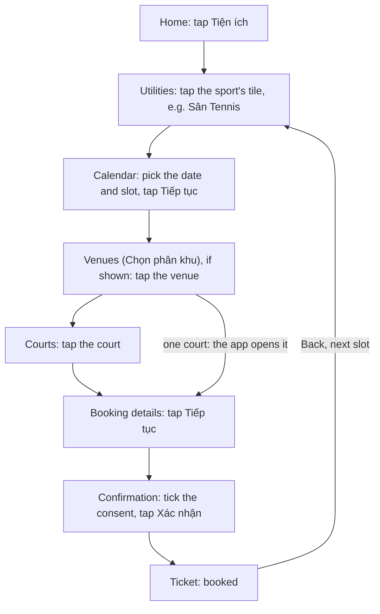
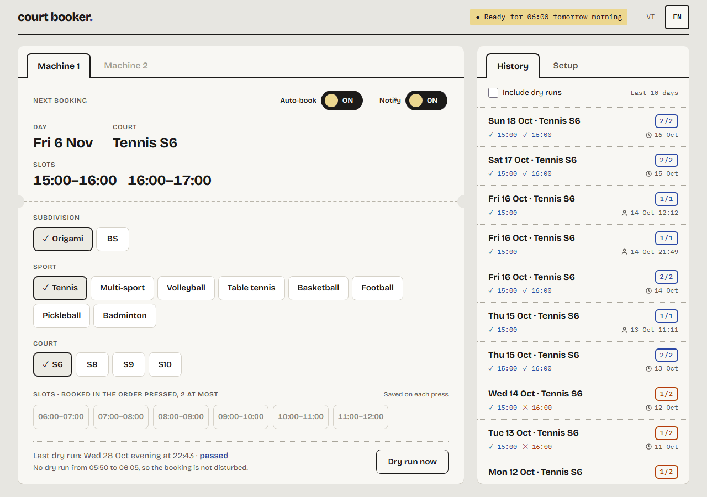
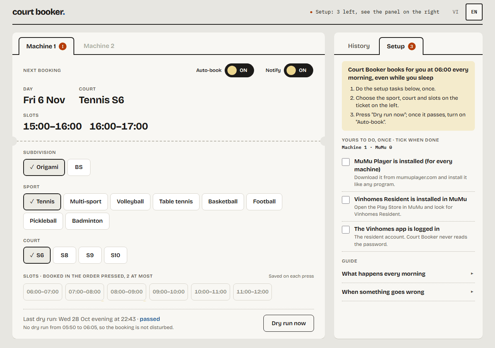

# vh-tennis-booker

[](https://github.com/servedbyhau/vh-tennis-booker/actions/workflows/ci.yml)


Books a sports court in the **Vinhomes Resident** app the moment bookings open, while its
owner sleeps.

**The problem.** The app opens each day's courts at 06:00, and the popular slots are gone
within seconds. Booking by hand means being awake, and fast, every morning.

**The approach.** A Windows scheduled task wakes the PC shortly before 06:00, starts the MuMu
Player Android emulator and taps through the app's own booking screens, as a person would.
Python reads each screen in one accessibility dump and finds every button by its label; a
small Android instrumentation driver written for the project does the taps, with
uiautomator2 as a fallback. It uses no private API and does not modify the app.

**The result.** It has booked real courts at 06:00 since 2026-10-10, since 2026-11-22 with
three MuMu instances side by side, each with its own account, court and slots; the first slot
usually has its ticket five to six seconds after the start. Beside the booking engine there is a
local FastAPI backend and a React and TypeScript UI, in Vietnamese and English, for the
settings, the schedule, the people booked for with their accounts, the tickets and the history of
every run, in a Tauri window.

It books tennis and the other courts a subdivision offers (multi-purpose, volleyball, table
tennis, basketball, football, pickleball, badminton), for the Origami and BS subdivisions so
far. It installs as a Windows app from one installer, with no Python needed, and updates
itself with one button.

> [!IMPORTANT]
> An educational, personal project, not affiliated with or endorsed by Vinhomes.


<sub>The app during a dry run, as of 1.0.0. All screenshots show made-up data.</sub>

## Highlights

- **Unattended and on time.** The PC wakes from sleep, and the run keeps NTP time on a
  counter Windows does not set, so the first tap goes out 0.1 s after 06:00:00.
- **One read per screen.** Each screen is one accessibility dump (about 13 ms) searched
  locally, so waiting for a screen and finding its button cost the same single read.
- **Reports only what the app showed.** A slot counts as booked only once the app shows its
  ticket (the booking confirmation); otherwise the round fails with the app's own message,
  or as "outcome unknown", never as booked.
- **Built for a slow app and a fragile emulator.** A tap the app ignores is repeated and a slow
  screen is awaited up to 30 s. Until two minutes before the start, whatever fails is repaired,
  a frozen emulator by restarting it; during the rounds one ends the run after 60 s instead of
  hanging until the next morning.
- **Books with the right account.** Before the start a run reads the phone number logged in, and
  logs out and in again if it is not the chosen account's; one that cannot be sure books nothing.
- **Tickets at hand.** After the rounds the app's own list of tickets is read and each new ticket
  pictured with its QR code, kept by customer until its day of play is over.
- **The quota in sight.** While getting ready and after the tickets, a run counts on the app's
  history page what the account used of the month's 8 bookings and the day's 2, and warns when
  fewer are left than the slots chosen; the quota section and each machine's card show what is
  left. When the next day's run would have too few, a notification, the machine's tab and its
  account say so, so another account can be chosen in time; a run never changes the account by
  itself.
- **Several accounts at once.** Each extra MuMu instance books with its own account, court
  and slots, in a process of its own, so one that fails holds up no other.
- **Tested without a device.** Fakes replace the emulator, ADB, the clock and Task
  Scheduler; CI runs Ruff, pytest on Python 3.9 to 3.14, and the UI's checks, tests and
  build.

## How it works



The app is built with Flutter, which publishes its widgets to Android's accessibility tree
with their text in `content-desc`. The booker reads each screen in one dump, finds the
buttons by their labels, and the driver finds them again in the current tree before
clicking. Coordinates distinguish duplicate labels and locate unlabelled controls; the
uiautomator2 fallback taps the points from the dump. A page with a single choice (one
venue, one court) passes on to the next by itself, and the booker goes on from whichever
page it reads. Each slot in `config.toml` is booked
in its own round, and one Back from the ticket returns to the utilities list for the next
one. The app may be set to Vietnamese or
English: the booker tells which from the first screen and uses that language's labels. The
Vietnamese labels live in `config.toml`, so a change of wording in the app needs no code
change; the English ones are built in.

A real 06:00 run, abridged (times are the PC clock, which was 0.161 s behind: the first
tap went out at 06:00:00.001 and is logged once the calendar showed):

```text
05:50:02.583 INFO    court-booker 0.6.1
05:50:02.718 INFO    Clock offset +0.161 s
05:50:04.894 INFO    Launching MuMu instance 0
05:50:29.704 INFO    Android started after 24.8 s
05:50:38.583 INFO    Ready on the home screen
05:59:00.694 INFO    Tapped 'Tiện ích'
05:59:59.839 INFO    Round 1/2: 15:00 - 16:00
06:00:01.427 INFO    Tapped 'Sân Tennis'
06:00:01.594 INFO    Selected date 2026-10-18
06:00:03.360 INFO    Selected slot 15:00 - 16:00 (0 swipe(s))
06:00:05.954 INFO    Tapped 'S6 - Sân tennis'
06:00:06.232 INFO    Confirmation page: 2026-10-18 15:00 - 16:00 on S6 - Sân tennis
06:00:06.439 INFO    Accepted terms
06:00:07.979 INFO    Booking confirmed
06:00:07.981 INFO    Round 2/2: 16:00 - 17:00
...
06:00:10.564 INFO      OK   15:00 - 16:00  booked  (8.1s)
06:00:10.564 INFO      FAIL 16:00 - 17:00  Court S6 - Sân tennis is fully booked  (2.6s)
```

Further reading:

- [docs/how-it-works.md](docs/how-it-works.md): reading a Flutter app from the outside,
  navigation, lessons learned
- [docs/architecture.md](docs/architecture.md): what each module, backend route and UI part
  does
- [docs/field-notes.md](docs/field-notes.md): the facts about the app and the emulator the
  code relies on
- [docs/roadmap.md](docs/roadmap.md): the goal, what is left and the situations handled

## Install

What you need:

- A Windows 10 or 11 PC that stays on or asleep at night, never shut down (a PC that is off
  cannot be woken), plugged in and signed in to Windows (a locked screen is fine).
- [MuMu Player](https://www.mumuplayer.com/). The app's **Setup** page installs the Vinhomes
  Resident app in it from an APK or XAPK file you downloaded (or install it from Google Play),
  and you log in to your resident account in it once.

Then:

1. Download **[CourtBooker-setup.exe](https://github.com/servedbyhau/vh-tennis-booker/releases/latest/download/CourtBooker-setup.exe)**
   from the [newest release](https://github.com/servedbyhau/vh-tennis-booker/releases/latest).
2. Run it. The installer is not code-signed, so Windows SmartScreen may say it protected your
   PC: choose **More info**, then **Run anyway**. It installs for you alone, without
   administrator rights.
3. Open **Court Booker** from the Start menu, and go through the **Thiết lập / Setup** page
   from top to bottom: it checks each step and says what is left.
4. On the ticket, choose the subdivision, the sport, the court and up to two slots, in the
   order you want them.
5. In the **Settings** beside it, turn **Auto-book** on. Every morning the PC wakes at the wake
   time and books at 06:00; the window does not need to be open.
6. To check the setup first, press **Dry run** between 06:05 and 21:00, while the Vinhomes app
   takes bookings (optional; the button waits outside those hours). It walks the whole booking and stops before the final
   confirmation, so nothing is booked.

If the PC did not wake one morning, the daily task runs as soon as the PC is on: before 06:00 it
still books. **Book now** beside **Dry run** books by hand, from the wake time to 21:00: before
06:00 it gets ready and books at 06:00, after it at once.

The app is in Vietnamese by default, English is one click away.

### Update

The version installed shows beside the app's name, at the top left. When a newer version is
out, the top of the window shows **Update to x.y.z**. One press downloads it, installs it over the app and opens it again; your settings, history and
morning booking stay. The button waits while a run is going on and around 06:00.

### Uninstall

In Windows Settings, open **Apps**, find **Court Booker** and choose **Uninstall**. This removes
the app and its morning booking. Your settings and history stay in
`%LOCALAPPDATA%\CourtBooker` (with the logs of every run, in `logs`); delete that folder to
remove them too.

## Using the app

The app has three pages, **Thiết lập / Setup**, **Đặt sân / Booking** and **Quản lý /
Management**. On the booking page:

- **The line at the top** says whether the next start is ready, or the one thing to do first:
  the daily switch, what the Setup page lacks for a machine that books (MuMu Player, its MuMu
  instance or the Vinhomes app; the words lead to that step), a machine that books with no
  account chosen, or two machines that would book the same court and slot. **Thiết lập / Setup**
  in the header shows in red how many of its steps are left.
- **The ticket** on the left, a card drawn like a ticket, is the next booking in two parts:
  on top what is set, the play day, court and slots; below, the subdivision, the sport, the
  court and up to two slots to choose, saved on each press. During a run it shows the steps as
  they happen; those of the 06:00 race (from a minute before to the last slot) show once it is
  over, so writing them takes nothing from the booking.
- **Cài đặt / Settings** on the right, what is used day to day: the daily switch (it creates
  or removes the Windows task; a dry run is not needed first), the Windows notification,
  whether the machine shown books (switching on one whose MuMu instance is not on the PC yet
  leads to the Setup page, where it is made), the account it books with (its phone number and
  name), picked by customer first, then by phone number, a dry run and **Book now**. Before booking, a run reads the phone number logged in on the machine's Vinhomes app,
  and logs out and in if it is not the chosen account's, trying the password once; a machine
  that cannot be sure books nothing.
- **A tab per machine** on top of the ticket, one for each MuMu instance on the PC, three at
  least: the others (each logged in to another account) book alongside the first once their
  switch in the Setup is on.

The **Setup** page holds what a new PC needs once, in six steps from top to bottom, each
checked by the app (a tick once done, and how many are; **Check again** reads them anew). It
opens on the first step not done:

1. **Keep the PC on**: plugged in, no sleep, no hibernation, closing the lid does nothing, the
   screen off after 5 minutes; off gives back the PC's own power settings.
2. **MuMu Player**: installed, or where to get it.
3. **Machines**: each MuMu instance (the app gives each 2 cores, 2 GB and a 540x1600 screen
   when it runs), with a button that opens it to see its screen (launched, or its window
   brought to the front); one not made yet has a button that makes it, a copy of the first machine's
   with the Vinhomes app, set up to book (about two minutes), or says the PC lacks the RAM or
   the disk for it.
4. **Vinhomes app**: a button that installs it from a file (an APK or XAPK you downloaded:
   installed on every MuMu instance once its signature is the app's own), then whether each
   machine has it. A machine that has been off since it was last checked is not known: its
   button opens it.
5. **Accounts**: the machines that book without an account chosen.
6. **Dry run and Auto-book**: the daily switch and a dry run.

On the **Management** page:

- **Tổng quan / Overview**, shown first: what to look at, only while there is something (the
  daily booking off, a machine without an account, two machines on one court and slot, an
  account short of quota, a last run that failed, tickets of today and tomorrow not sent), each
  leading where it is set right; then every machine in a line with the account it books with,
  what it books and how its last 06:00 run went, the day of that run on top.
- **Khách hàng / Customers**: the people or groups you book for, each with who speaks for them and
  the Vinhomes accounts they gave, each with its whole phone number and a button that copies it. A
  search over the list finds a customer by name or contact, or an account by its name or phone
  number (marked once found). The quotas are in the quota section. The passwords are kept by
  Windows (Credential Manager) for your Windows account; an account's form shows its own. The
  customers export to an Excel file (an account a row, the passwords only when ticked: to keep a
  copy or move them to another PC), and a file in the same columns, such as the template, imports
  many at once: what it adds, changes and leaves out (with why) shows first. A customer is found
  by name, an account by phone number; a known number gets the file's name and password.
- **Vé / Tickets**: the tickets booked and still to use, of every customer in one list or one alone,
  by day of play or as a week (a column a day, a row a slot), of one sport or every one, every
  ticket or those not sent to their customer yet. Each day says how many are not sent yet. A
  ticket shows its slot and court, a mark while it has its picture, its status only when it is not
  the usual "registered", and the account it was booked with (its customer too while several
  customers' tickets show); a button beside it marks it sent or not. A press on the ticket opens
  its picture, where a button marks it sent too,
  with its QR code, and buttons save it as a file and copy it, to paste it where it is sent. A
  ticket still to play has a button that cancels it in the Vinhomes app, after a question: the
  machine its account is on opens the ticket and cancels it (about a minute), and the quota
  comes back. Not around the 06:00 booking, nor while a run uses that machine. They are read from the Vinhomes app at 06:03,
  once every machine has booked, and stay on this PC, the pictures in
  `%LOCALAPPDATA%\CourtBooker\tickets`, until the day of play is over.
- **Hạn mức / Quota**: the customers on the left (with the same search as the customers' page),
  one marked when an account has one booking or none left of a sport; beside them the chosen
  customer's accounts in rows and their sports in columns, what each booked in the month booked
  for (or another month read), "3/8", or "Full" at the limit, and a button that reads an account
  on a machine again.
- **Thống kê / Statistics**: what the 06:00 runs of the last 30 days tell: the share of slots
  booked by machine and by slot, how long a slot booked took on average, and why slots were lost.
- **Lịch sử / History**: each run in two lines, its play day, court and count ("2/2"), then every
  slot booked or not and when it started (real bookings, dry runs on request); a press shows the
  reasons, the steps and the technical log beside the list. A booking that stopped on a failure the
  app did not explain also saved a screenshot of MuMu in `%LOCALAPPDATA%\CourtBooker\logs\screens`.

<p>
  
  
</p>

## Project layout

```text
src/court_booker/       booking engine and command line: emulator, ADB, flow, clock, history
src/court_booker/api/   FastAPI backend, which also serves the UI in the installed app
ui/                     the UI: React, TypeScript, Vite
desktop/                the window and the installer: Tauri, Rust
packaging/              the PyInstaller build of the engine and backend
android/                the instrumentation driver that taps in the emulator
tests/                  Python tests with a fake device, ADB, clock and Task Scheduler
tools/                  app build, release, screen inspector, OpenAPI export
docs/                   how it works, architecture, field notes, command line, roadmap, spec
```

[docs/architecture.md](docs/architecture.md) says what each module does.

## Development

```bash
git clone https://github.com/servedbyhau/vh-tennis-booker.git
cd vh-tennis-booker
pip install -e ".[dev,app]"
pre-commit install
pytest
cd ui && npm ci && npm test
```

[docs/command-line.md](docs/command-line.md) runs the engine, the backend and the UI from the
clone, with every command, setting and exit code. When the app changes its screens,
`python tools/inspect_screen.py --near "Tôi đã hiểu"` prints the elements around a label.
[CONTRIBUTING.md](CONTRIBUTING.md) covers the checks, conventions, branches, building the app
and releases.

## Roadmap

The 0.x versions go through four phases toward 1.0.0: it runs, it handles every situation,
it is fast, it is friendly to use. 1.0.0 is the first complete version: the desktop app with
its installer and update button, which books every morning ([changelog](CHANGELOG.md)).
See [docs/roadmap.md](docs/roadmap.md).

## Credits

The UI ships the fonts [Bricolage Grotesque](https://github.com/ateliertriay/bricolage)
(© 2022 The Bricolage Grotesque Project Authors) and
[IBM Plex Mono](https://github.com/IBM/plex) (© 2017 IBM Corp.), both under the
[SIL Open Font License 1.1](https://openfontlicense.org), through the
[Fontsource](https://fontsource.org) packages. Its icons are [Lucide](https://lucide.dev)'s
([ISC](https://lucide.dev/license)), through `lucide-react`.

## License

[MIT](LICENSE)
